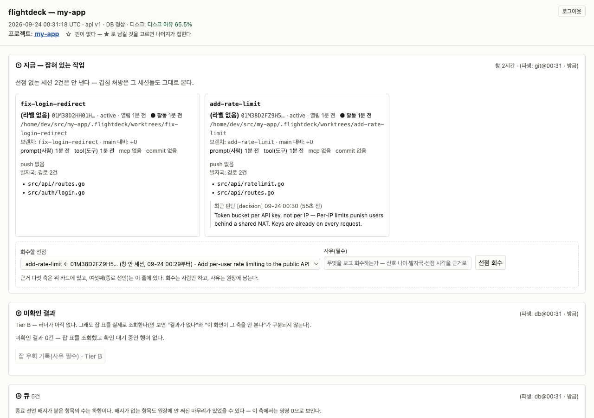

[English](README.md) | **한국어**

# flightdeck

**병렬 에이전트 세션을 위한 조정 계층.** 자체 호스팅 서버 하나에 Claude Code 와 codex 세션이
붙어, 서로가 무엇을 하고 있는지 보면서 일한다.

세션끼리는 대화할 수단이 없다. 그래서 각 세션은 "저쪽이 뭘 집었나"를 추측하고, 추측이 틀리면
남이 하던 일을 통째로 다시 한다. flightdeck 은 그 추측을 없앤다 — 누가 살아 있나 · 어느 경로를
만지나 · 무엇을 집었나를 **git 과 데이터베이스에서 파생해** 모든 세션에 보여 준다.

새 세션을 열면 아무것도 안 쳐도 보드가 먼저 뜬다.

```
보드 · my-app · 2026-08-13 06:40 UTC · 파생 git@06:40:08 최신
잡혀 있는 작업 0건 (선점 기준이다 — 세션의 생사가 아니다)

잡혀 있는 작업이 없다 — 아무 세션도 큐 항목을 쥐고 있지 않다. 서버 장애가 아니다.
창 밖 73건 (가장 오래된 신호 8일 10시간 전) — 창은 표시 구간이지 생존 판정이 아니다
큐 열림 4건
  · 19시간 22분·티클러(08-19 발화) · fd-folded-multi-turn-drain-unmeasured — 다턴 배수가 미실측이다
  · 18시간 41분·티클러(08-26 발화) · fd-lane-turn-remeasure-… — lane-turn 축을 재측한다
랜딩 레인 0건(질의는 돌았다)
```

같은 보드가 <http://localhost:7420> 에 읽기 전용 대시보드로도 뜬다.



<sub>데모 서버에 합성 데이터(`my-app`)를 넣고 찍은 화면이다.</sub>

## 특징

- **락 대신 선점** — `pick` 이 큐 항목을 집으면 그 id 가 그대로 브랜치·워크트리 이름이 된다.
  배타로 쥐는 것은 머지 하나뿐이다.
- **머지 전에 보이는 겹침** — 훅이 편집마다 미커밋 발자국을 보고한다. 두 세션이 같은 경로를
  만지면 턴이 끝날 때 양쪽에 알린다. 막지는 않는다.
- **랜딩 레인** — 머지 앞의 직렬 줄. 차례가 아니면 `fd land` 가 1로 끝나므로
  `fd land && git merge --ff-only "$BRANCH"` 한 줄이 그대로 옳다.
- **항목을 따라다니는 판단** — 왜 그렇게 했나, 무엇을 기각했나, 무엇을 일부러 안 했나를 남기면
  그 항목을 다음에 집는 세션이 전문으로 받는다.
- **적지 않고 파생한다** — 브랜치·HEAD·발자국·활동 신호는 git 과 훅에서 온다. 파생할 수 있는
  사실에는 쓰기 API 가 아예 없다.
- **Claude Code 와 codex 를 한 보드에** — 두 하네스의 세션이 같은 겹침 판정을 받는다.
- **서버가 죽어도 조용하지 않다** — 모든 세션에 배너를 띄우고 되는 것과 안 되는 것을 나눠 말한다.

## 동작 방식

1. **서버** — Go 바이너리 하나(SQLite)를 Docker 로 띄운다. 저장소를 읽기 전용으로 마운트해
   브랜치·커밋·미커밋 변경을 직접 읽는다.
2. **훅** — 세션을 등록하고, 활동 신호와 편집 발자국을 보내고, 턴이 끝날 때 겹침 같은 처방을
   세션에 주입한다.
3. **도구** — 에이전트는 MCP 도구로, 사람은 터미널 `fd` 로 같은 동작을 부른다.
4. **대시보드** — <http://localhost:7420> 에 읽기 전용 보드 한 장.

한 세션의 하루는 이렇게 흐른다.

```
세션 시작      SessionStart 훅이 보드를 주입한다
pick           무엇을 집을지 추천만 한다 (선점하지 않는다)
pick(item_id)  선점 + 항목 본문 + 연결된 판단 + 워크트리 명령
작업           PostToolUse 훅이 편집마다 발자국을 보고한다
finish         판단 + 후속 등록 + 종료 + 반납을 한 트랜잭션으로
land           랜딩 줄에 선다 → 차례가 오면 머지 → land(result: ok)
```

겹침·랜딩 레인·항목 상태·활동 신호의 자세한 모양은 [개념과 동작](docs/concepts.ko.md)에 있다.

## 빠른 시작

필요한 것: **Docker**(서버 머신) · **Go 1.25 이상**(세션을 돌리는 머신 — `bin/fd` 가 첫 호출에
빌드한다) · git.

**1. 서버를 띄운다** — 한 머신에서 한 번.

```bash
git clone https://github.com/Kweiza/flightdeck.git
cd flightdeck
docker compose up -d
curl -s localhost:7420/healthz     # {"ok":true,"api_version":"1","db_ok":true,…}
```

**2. 플러그인을 설치한다** — 세션을 돌리는 머신마다.

```
/plugin marketplace add Kweiza/flightdeck
/plugin install flightdeck@flightdeck
```

**3. 세션을 연다.** 보드가 먼저 뜨면 된 것이다. 일은 `/fd-pickup` 으로 시작한다.

> 1·2 단계는 `/fd-setup` 스킬이 대신 해 준다 — 이 머신이 서버인지 클라이언트인지 묻고,
> 없는 것만 승인받아 설치한다.

- **서버가 다른 머신이면** 세션 쪽에 `FD_URL=http://<서버>:7420` 을 준다(토큰을 쓰면 `FD_TOKEN` 도).
- **도커 없이** 돌리려면 `cd server && go run ./cmd/fd serve --addr :7420 --db ~/.flightdeck/fd.db`.
  컨테이너와 같은 DB 를 가리키므로 **둘을 같이 돌리지 마라.**
- **이미 `flightdeck@kweiza-cc-plugins` 로 깔았다면** 그대로 둬라 — 같은 저장소를 받는다. 둘을 함께 켜지는 마라.

## 쓰는 법

### 세션 안에서 — MCP 도구 10개

외워야 할 것은 넷이다: 집고(`pick`) · 남기고(`note`) · 끝내고(`finish`) · 줄 선다(`land`).

| 도구 | 하는 일 |
|---|---|
| `board` | 지금 누가 무엇을 쥐고 있나 |
| `pick` | 인자 없으면 추천만 한다. `item_id` 를 주면 선점, `leave` 를 주면 반납 |
| `note` | 판단을 남긴다 — `decision` `handoff` `blocked` `ask` `rejected` `not-done` `verified` `draft` |
| `add` | 큐 항목을 만든다. id 가 그대로 브랜치 이름이 된다 |
| `finish` | 판단 + 후속 등록 + 종료 + 반납을 한 트랜잭션으로 |
| `land` | 랜딩 레인(또는 이름 붙인 자원)의 줄에 선다 / 보고하고 반납한다 |
| `alloc` | 원자 발번 — 개정 차수 같은 논리 카운터 |
| `label` | 표시용 꼬리표 |
| `amend` | 항목의 제목·본문·경로를 고친다. 옛 값은 개정 이력에 남는다 |
| `show` | 항목 하나를 읽는다 — 닫힌 항목도 된다 |

### 터미널에서 — `fd`

```bash
fd status                         # 서버 상태 배너 + 보드
fd next                           # 추천만
fd pick <item-id>                 # 선점
fd finish <item-id> --outcome done --body "왜 · 기각한 것 · 안 한 것 · 확인한 것"
fd land && git merge --ff-only "$BRANCH"
fd doctor                         # 이 머신과 서버의 상태를 실제로 잰다
```

### 스킬 4개

| 스킬 | 언제 |
|---|---|
| `/fd-setup` | 머신을 처음 켤 때 — 서버/클라이언트를 정하고 필요한 것만 설치·기동 |
| `/fd-pickup` | 세션을 시작할 때 — 보드 → 추천 → 선점 → 연결된 판단 읽기 |
| `/fd-handoff` | 작업을 마칠 때 — 판단·후속·종료·반납을 한 호출로 |
| `/fd-update` | 서버·플러그인·DB 를 최신으로 |

파라미터 전체와 쓰는 규율은 [도구 레퍼런스](docs/reference.ko.md)에 있다.

### 소유자 칸반: `board/`

사람이 큐를 칸반으로 보고 그 자리에서 답하는 웹 보드(파이썬 표준 라이브러리 한 파일, 호스트 프로세스).
열은 꼬리표(`status:running` · `status:owner` · `status:owner-done` · `status:owner-ask`)로 갈리고, 카드는 본문의
규약 줄(`미리보기:` · `그림:` · `커밋:` · `소유자:` · `선택:` …)로 그려진다. 세션은 그 규약을 MCP 안내문 한 줄로 받는다.
설치 · 설정 · 규약 전문은 [board/README.ko.md](board/README.ko.md).

## codex

```bash
fd setup --install-codex   # ~/.local/bin/fd-hook · ~/.local/bin/fd · ~/.codex/hooks.json
codex                      # 한 번은 TUI 로 띄워 "Hooks need review" 를 승인한다
```

- **승인 전에는 훅이 아무 말 없이 안 돈다.** 확인은 `fd doctor` 의 codex 절로 한다.
- codex 기본 샌드박스는 네트워크를 끊는다 — `codex -c sandbox_workspace_write.network_access=true`.
- `~/.local/bin` 을 PATH 에 넣는다. codex 에는 MCP 도구가 없고 터미널 `fd` 를 쓴다.

왜 그렇게 생겼는지와 되는 것·안 되는 것의 전체 표는 [codex 에서 쓰기](docs/codex.ko.md)에 있다.

## 설정

서버는 compose 가 읽는 환경 변수로, 세션은 `fd setup` 이 쓰는 `~/.flightdeck/config.json` 이나
환경 변수로 설정한다. Postgres 원장의 변수(`FD_PG_*` · `FD_BACKUP_HOST`)는 덮개 파일 `compose.postgres.yaml` 을 얹을 때만 읽힌다(아래 「Postgres 원장」).

| 변수 | 쪽 | 뜻 |
|---|---|---|
| `FD_TOKEN` | 서버 · 세션 | 인증 토큰. 안 주면 인증 없이 뜨고 `/healthz` 가 그 사실을 알린다 |
| `FD_REPOS` | 서버 | 저장소가 있는 자리(기본 `$HOME`). 파생의 전부가 여기서 나온다 — **갱신할 때 잃지 마라** |
| `FD_REPOS2`–`FD_REPOS4` | 서버 | 저장소가 여러 트리에 흩어져 있을 때 추가 마운트 |
| `FD_UID` · `FD_GID` | 서버 | 호스트 사용자 id(기본 1000) |
| `FD_LEDGER_HOST` | 서버 | 원장 백업 자리(기본 `~/.flightdeck-ledger`) |
| `FD_BACKUP_DIR` | 서버 | `fd migrate` 가 Postgres 원장의 판을 올리기 전에 뜨는 덤프 자리(`--backup-dir` 가 먼저고, 둘 다 비면 `/backups` 가 있을 때 그곳). Postgres 겹의 compose 는 `/backups`(호스트 쪽은 `FD_BACKUP_HOST`)로 준다. **배포마다 따로 둔다**: 물리 복제로 떠 온 시험 시스템은 원래 시스템과 원장 식별(클러스터 식별자 · DB 이름)이 같아서, 한 자리를 나눠 쓰면 되돌리기가 다른 배포의 덤프를 고를 수 있다 |
| `FD_DUMP_TIMEOUT` | 서버 | Postgres 원장의 덤프 한 번의 기한(Go 시간 표기, 기본 `30m`, 1초 이상). `fd migrate` 가 판을 올리기 전에 뜨는 덤프와 `db-backup` 의 매일 덤프가 같은 값을 쓴다 - 둘 다 「이 원장의 정상 덤프 시간 + 여유」다. 판올림 전 덤프 동안에는 업무 쓰기가 기다리므로, 덤프가 멈추면(백업 볼륨이 응답을 멈추면) 이 기한이 쓰기가 막히는 가장 긴 시간이다. 기한이 지나면 pg_dump 를 멈추고 서버가 실행기 연결을 끊어 잠금을 풀며, 판은 올리지 않는다. 매일 덤프는 기한이 지나면 pg_dump 를 끊고 그날을 실패로 친다(멈춘 덤프가 표 잠금을 쥔 채 서 있으면 `fd migrate` 의 DDL 이 실패한다). 큰 원장에서 정상 덤프가 더 걸리면 늘린다 |
| `FD_BACKUP_HOST` | 서버 | Postgres 겹의 덤프 자리(기본 `~/.flightdeck-backups`). `fd migrate` 의 판올림 전 덤프가 바로 아래에, `db-backup` 의 매일 덤프가 `daily/<DB>/` 에 쌓인다(새것 14개). **미리 만들고**(주인 `FD_UID`, 권한 `0700`) **배포마다 따로 둔다**: 같은 DB 이름을 쓰는 두 배포가 한 자리를 나누면 서로의 덤프로 때를 재고 서로의 덤프를 회전한다. 준비는 아래 「Postgres 로 띄우기」 |
| `FD_PG_SERVER_PGPASS_HOST` · `FD_PG_BACKUP_PGPASS_HOST` | 서버 | Postgres 겹의 접속 계정 둘(서버 · 매일 덤프)의 pgpass 파일. **기본값이 없다** - 비면 Postgres 겹의 `up` 이 선다. 주인 `FD_UID`, 권한 `0600`, 줄 `db:5432:<DB>:<계정>:<비밀번호>`. 비밀번호가 들어가는 유일한 자리다(환경 변수 · 명령줄 · URL 에 두지 않는다). **서버 마운트 밖에 둔다** - 서버는 `FD_REPOS`(기본 홈 전체)를 읽는다(아래 「Postgres 로 띄우기」) |
| `FD_PG_DATABASE` · `FD_PG_SERVER_USER` · `FD_PG_BACKUP_USER` | 서버 | Postgres 겹의 DB 와 접속 계정 이름(기본 `flightdeck` · `fd_server` · `fd_backup`, 소문자 · 숫자 · `_` 만). 계정은 `db-roles` 가 만들고 잰다 - 서버 계정은 `fd_app`, 덤프 계정은 `pg_read_all_data` 의 구성원이고 특권 속성이 없다. 덤프 자리는 DB 마다 따로라(`daily/<DB>/`) DB 를 바꿔도 옛 DB 의 덤프를 새 DB 가 세거나 지우지 않는다 |
| `FD_URL` | 세션 | 서버 주소(기본 `http://127.0.0.1:7420`) |
| `FD_STATE_DIR` | 세션 | 상태 파일(아웃박스·캐시·머신 id)을 한 자리로 모은다 |
| `FD_LANG` | 서버 · 세션 | 출력 언어. `en` 이면 영어로 낸다(기본 한국어). 서버 쪽은 대시보드, 세션 쪽은 CLI·훅·MCP 결과다 |

각 변수의 함정과 이유는 [서버 운영](docs/server.ko.md)에 있다.

`FD_LANG=en` 은 **출력 경계에서** 옮긴다 — 보드, 대시보드, add·next·pick·note·finish·show, land,
꼬리, Stop 처방이 1차 범위다. 번역표(`server/internal/lang/catalog.go`)에 없는 줄은 **줄째 한국어로**
남는다(반쪽 번역을 안 낸다). `fd doctor`·로그인 화면·드문 진단 문구는 아직 한국어다.

## Postgres 원장

기본 배포의 원장은 SQLite 파일 하나(`~/.flightdeck/fd.db`)다. Postgres 원장은 **고를 때만** 켜진다: 덮개 파일
`compose.postgres.yaml` 을 `compose.yaml` 위에 얹으면 원장 DB(`db`, Postgres 17) · 접속 계정 one-shot(`db-roles`) · 매일
덤프(`db-backup`)가 붙고, `migrate` 와 서버가 그 DB 를 본다. 얹지 않은 `docker compose up` 은 이 판에서도 그대로 SQLite 다.

| 서비스 | 붙는 계정 | 길 · 하는 일 |
|---|---|---|
| `migrate` | 초사용자 `postgres` | 소켓 볼륨(trust). 스키마를 올리고, 손으로 하는 관리 명령(옮기기 · 되돌리기 · 되살리기 · psql)을 맡는다 |
| `db-roles` | 초사용자 | 소켓. 접속 계정 둘을 만들고 재고 비밀번호를 둔다(`deploy/db-roles.sh`). 어긋난 계정은 고치지 않고 멈춘다 |
| `flightdeck` | 서버 계정(`fd_app` 의 구성원) | TCP `db:5432`, pgpass 파일 |
| `db-backup` | 덤프 계정(`pg_read_all_data` 의 구성원) | TCP, pgpass 파일 |

초사용자는 비밀번호가 없다(아무도 모르는 난수로 초기화한다). 네트워크로는 못 붙고, 소켓 볼륨을 붙인 `migrate` ·
`db-roles` 만 붙는다. `db` 는 포트를 내지 않는다.

### Postgres 로 띄우기

**준비** - 한 번. `FD_UID` 인 사용자로 돌린다.

```bash
# 1. 볼륨 둘. 프로젝트 밖의 고정 이름이라 판마다 디렉토리가 바뀌어도 같은 원장이고, `down -v` 가 못 지운다.
#    compose 가 만들지 않는다 - 없으면 빈 원장을 새로 만드는 대신 `up` 이 선다.
docker volume create flightdeck-pgdata && docker volume create flightdeck-pgrun

# 2. 덤프 자리. 없으면 Linux 의 Docker 가 root 소유 0755 로 만들어 첫 덤프부터 못 쓴다.
install -d -m 0700 "${FD_BACKUP_HOST:-$HOME/.flightdeck-backups}"

# 3. 접속 계정 둘의 pgpass. 서버 마운트 밖(아래 ★), 주인 FD_UID, 권한 0600, 한 줄씩.
sudo install -d -m 0700 -o "$(id -u)" -g "$(id -g)" /etc/flightdeck
(umask 077
 printf 'db:5432:flightdeck:fd_server:%s\n' "$(openssl rand -hex 24)" > /etc/flightdeck/server.pgpass
 printf 'db:5432:flightdeck:fd_backup:%s\n' "$(openssl rand -hex 24)" > /etc/flightdeck/backup.pgpass)

# 4. 고른 것을 한 파일에 적는다. 비밀번호는 없고 파일 자리만 있다.
cat > ~/.flightdeck/compose.env <<'EOF'
COMPOSE_FILE=compose.yaml:compose.postgres.yaml
FD_PG_SERVER_PGPASS_HOST=/etc/flightdeck/server.pgpass
FD_PG_BACKUP_PGPASS_HOST=/etc/flightdeck/backup.pgpass
EOF
fdc() { COMPOSE_ENV_FILES="$HOME/.flightdeck/compose.env" docker compose "$@"; }   # 셸 설정에 둔다
```

- `fdc` 는 그 파일을 compose 의 env 파일로 준다(`COMPOSE_ENV_FILES`, `--env-file` 과 같다). `COMPOSE_FILE` 이 덮개 파일을
  얹는다 - 경로는 compose 를 돌리는 디렉토리 기준이라 저장소(또는 플러그인 설치본)의 루트에서 돌린다. 다른 설정(`FD_TOKEN` ·
  `FD_REPOS` · `FD_UID` …)은 지금처럼 셸에서 준다. 셸 값이 이 파일보다 먼저고, 이 파일을 주면 그 디렉토리의 `.env` 는 안
  읽는다. `fd-update` 스킬도 이 파일이 있으면 같은 길로 준다.
- 비밀번호는 공백 · 역빗금 · 콜론이 없는 인쇄 가능한 ASCII 여야 한다. 같은 파일을 서버(pgx)와 매일 덤프(libpq)가 읽는데
  두 구현이 그 밖의 글자를 다르게 푼다. `db-roles` 가 어긋난 줄을 줄 번호와 함께 거절한다(비밀번호는 안 낸다).
- DB · 계정 이름을 바꾸면(`FD_PG_DATABASE` · `FD_PG_SERVER_USER` · `FD_PG_BACKUP_USER`, compose.env 에) pgpass 의 줄도 같이
  바꾼다.

★ **pgpass 를 서버 마운트 밖에 둔다.** 서버는 같은 uid 로 `FD_REPOS`(기본 홈 전체)를 읽기 전용으로 붙인다. 홈 안에 두면
`0600` 이어도 서버가 덤프 계정의 비밀번호까지 읽는다. 그래서 compose 는 두 자리에 기본값을 두지 않는다 - 비면 `up` 이 선다.

**띄우기**

```bash
fdc up -d --build
fdc ps                              # db · flightdeck · db-backup 은 healthy, migrate · db-roles 는 Exited (0)
curl -s localhost:7420/healthz      # db_ok · db_locale_ok 가 true
```

빈 원장이면 `migrate` 가 기준선부터 깐다. **SQLite 원장을 들고 옮기려면** 이렇게 띄우지 말고 아래 「업그레이드: SQLite
원장을 Postgres 로」를 따른다 - `~/.flightdeck/fd.db` 가 이관 표지 없이 남아 있으면 이렇게 띄운 `migrate` 가 거절한다(이관을
거치지 않은 새 원장).

**관리 명령**은 `migrate` 서비스로 한다. 원장(`/data`) · 덤프 자리(`/backups`) · psql · pg_dump · pg_restore 가 그 안에 있고,
초사용자로 소켓에 붙는다. `--no-deps` 는 `db` 가 떠 있을 때 쓴다.

```bash
fdc run --rm --no-deps migrate selfcheck                                                # 판 · 증분 계획
sql() { fdc run --rm --no-deps --entrypoint psql migrate -X -v ON_ERROR_STOP=1 "$@"; }    # 초사용자 psql
```

- **손으로 `fd migrate` 를 돌리기 전에는 `fdc stop db-backup`** 한다. pg_dump 는 끝날 때까지 모든 표의 잠금을 쥐고, 판을
  올리는 DDL 은 그 잠금을 lock_timeout(5초) 안에 못 얻으면 실패한다. `fdc up` 이 migrate 를 다시 만들 때(새 이미지 · 설정)는
  compose 가 매일 덤프를 먼저 멈췄다가 migrate 가 성공한 뒤 다시 띄운다(`depends_on` 의 `restart: true`). `run` 과
  `up --no-deps migrate` 에는 그것이 없다.
- **비밀번호를 바꾸려면** 두 pgpass 파일을 **제자리에서** 고치고(새 파일로 바꿔 끼우면 붙어 있는 컨테이너에서 파일이
  사라진다) `fdc up -d --force-recreate --no-deps db-roles flightdeck db-backup` 한다. 서버는 기동 때 한 번 읽는다.

★ **원장 하나에 덮개 하나.** 이관은 커밋한 뒤 SQLite 원장 옆에 이관 표지(`~/.flightdeck/fd.db.moved-to-postgres`)를 남긴다.
옮긴 뒤 `fdc` 대신 `docker compose` 만 치면 기본 경로(SQLite)의 `migrate` 가 그 표지를 보고 원장을 열지도 새로 만들지도 않아
서버가 안 뜬다 - `docker compose down` 뒤 `fdc up -d` 로 다시 띄운다. 거꾸로 덮개를 얹은 `migrate` 는 표지 없는 `fd.db` 가
남아 있으면 거절한다. 표지는 아래 「72시간 안에 되돌리기」만 지운다.

### 업그레이드: SQLite 원장을 Postgres 로

SQLite 판에서 쌓은 원장을 들고 Postgres 원장으로 넘어가는 절차다. 옮기는 동안 서버는 내려가 있다. 옮긴 뒤 72시간은
Postgres 에 쌓인 것까지 들고 SQLite 로 되돌릴 수 있다(아래 「72시간 안에 되돌리기」).

**원장이 판 18 이어야 한다.** 이관은 마지막 SQLite 판(18)만 받는다. 더 옛 판이면 이 판의 기본 경로로 먼저 판을 올린다 -
아래 3 이 그것이고, 판이 18 인 것을 본 뒤에 4 로 간다.

```bash
# 0. 「Postgres 로 띄우기」의 준비(볼륨 · 덤프 자리 · pgpass · compose.env · fdc)를 마친다. 띄우지는 않는다.
# 1. 지금 마운트를 읽어 둔다. FD_REPOS 등은 마운트에만 남아 내리면 못 읽는다. 그 값을 아래 명령들의 셸에 준다.
docker inspect flightdeck --format '{{range .Mounts}}{{.Source}} -> {{.Destination}} {{if .RW}}rw{{else}}ro{{end}}{{"\n"}}{{end}}'
# 2. 서버를 내리고 이 판의 이미지를 짓는다.
docker compose down
docker compose build
# 3. SQLite 원장을 이 판으로 올린다(이미 18 이면 아무것도 안 한다). selfcheck 가 「스키마 버전 18」을 내야 한다.
docker compose run --rm --no-deps migrate migrate --db /data/fd.db
docker compose run --rm --no-deps migrate selfcheck --db /data/fd.db
# 4. Postgres 원장을 띄우고 기준선만 깐다(판 18 에서 멈춘다). db 가 같이 뜬다.
fdc run --rm migrate migrate --to 18
# 5. 예행 → 옮기기 → 맞대기. 옮기기가 커밋한 뒤 원본 옆에 이관 표지(fd.db.moved-to-postgres)를 남긴다.
fdc run --rm --no-deps migrate migrate import-sqlite --from /data/fd.db --dry-run
fdc run --rm --no-deps migrate migrate import-sqlite --from /data/fd.db
fdc run --rm --no-deps migrate migrate verify --from /data/fd.db
# 6. 옮긴 SQLite 원장의 이름을 바꾸고 읽기 전용으로 둔다. 옆 파일(-wal · -shm)도 같이 옮긴다 - 이관이 원본을 읽기 전용으로
#    열어도 빈 옆 파일이 생긴다.
t=$(date -u +%Y%m%dT%H%M%SZ)
for s in '' -wal -shm; do [ ! -e ~/.flightdeck/fd.db$s ] || mv ~/.flightdeck/fd.db$s ~/.flightdeck/fd.db.pre-pg-$t$s; done
chmod 0444 ~/.flightdeck/fd.db.pre-pg-$t
# 7. Postgres 원장으로 띄운다. 보드에 옮긴 항목이 보이면 된 것이다.
fdc up -d
curl -s localhost:7420/healthz      # db_ok · db_locale_ok 가 true
```

- 5 의 예행이나 옮기기가 거절 · 실패하면 아무것도 커밋되지 않는다(트랜잭션 하나). SQLite 원장은 읽기만 했다. 사유를 고치고
  5 부터 다시 돌거나, `fdc down` 뒤 `docker compose up -d` 로 SQLite 판으로 돌아간다.
- 거절 갈래와 대조의 자세한 모양은 아래 「SQLite 원장을 Postgres 로 옮기기」에 있다.

#### 72시간 안에 되돌리기

옮긴 뒤 72시간을 되돌리기 창으로 둔다. `export-sqlite` 가 Postgres 원장을 판 18 의 **새** SQLite 파일로 옮기므로, 옮긴 뒤
Postgres 에 쌓인 항목 · 선점 · 판단도 같이 돌아온다. 이 창 동안은 Postgres 스키마를 18 위로 올리는 flightdeck 판으로
갱신하지 않는다 - `export-sqlite` 는 판 18 의 원장만 받는다.

```bash
# 1. 서버와 매일 덤프를 내린다(db 는 둔다). 붙은 연결이 있으면 역이관이 거절한다.
fdc stop flightdeck db-backup
# 2. 예행 → 옮기기 → 맞대기. 맞대기는 빼지 않는다.
fdc run --rm --no-deps migrate migrate export-sqlite --to /data/fd-back.db --dry-run
fdc run --rm --no-deps migrate migrate export-sqlite --to /data/fd-back.db
fdc run --rm --no-deps migrate migrate verify --from /data/fd-back.db
# 3. Postgres 겹을 내리고 낸 파일을 원장 자리에 둔다(옆 파일도 같이).
fdc down
for s in '' -wal -shm; do [ ! -e ~/.flightdeck/fd-back.db$s ] || mv ~/.flightdeck/fd-back.db$s ~/.flightdeck/fd.db$s; done
rm ~/.flightdeck/fd.db.moved-to-postgres   # 이관 표지 - 남기면 SQLite 쪽 migrate 가 이 원장을 열지 않는다
# 4. Postgres 를 고른 파일을 치우고 기본 경로(SQLite)로 띄운다. 남겨 두면 다음 갱신이 다시 Postgres 겹을 얹는다.
mv ~/.flightdeck/compose.env ~/.flightdeck/compose.env.off
docker compose up -d
```

- 3 의 자리에 `~/.flightdeck/fd.db` 가 이미 있으면(옮긴 뒤 기본 경로로 잘못 띄워 생긴 빈 원장) 덮기 전에 열어 보고 치운다.
- verify 가 어긋나면 `fd-back.db` 를 지우고 서버를 내린 채 1 부터 다시 돈다.
- Postgres 원장(볼륨 `flightdeck-pgdata`)은 그대로 남는다. 다시 옮길 때 이관은 빈 대상만 받는다.

### Postgres 원장의 매일 덤프

`db-backup` 서비스가 `pg_dump -Fc` 를 하루 한 번 `$FD_BACKUP_HOST/daily/<DB>/fd-daily-<UTC>.dump` 로 뜨고 새것 14개만
남긴다. Postgres 겹을 얹을 때만 뜬다(준비는 「Postgres 로 띄우기」). 회전은 덤프가 성공한 뒤에만 하고, 한 DB 자리에서는 한
실행만 돈다. 가장 새 덤프가 간격 + 확인 두 번 + 기한(기본 26시간 30분)보다 낡으면 컨테이너가 unhealthy 다.

설정은 `fdc run --rm --no-deps db-backup config` 가 한 줄로 낸다. 손으로 한 번 뜨려면 `once` 다(0 = 떴거나 아직 때가
아니다, 1 = 실패, 3 = 다른 실행이 같은 자리에서 돌고 있어 아무것도 안 했다).

**되살리기** - `migrate` 서비스로 한다(초사용자 · 소켓, 덤프가 `/backups` 에 보인다). `sql` 은 위 「Postgres 로 띄우기」의
관리 명령이다.

```bash
fdc stop flightdeck db-backup      # 되살릴 DB 에 붙은 연결을 끊는다
```

1. 덤프가 되살릴 DB 이름을 덤프에서 읽는다. `--create` 는 지금 `FD_PG_DATABASE` 가 아니라 **덤프에 적힌 이름**으로 DB 를 만든다.

   ```bash
   fdc run --rm --no-deps --entrypoint pg_restore migrate -l /backups/daily/<DB 자리>/fd-daily-<UTC>.dump | grep '^; *dbname:'
   ```

   그 이름의 DB 가 이미 있으면 지우지 말고 **이름을 바꿔 남긴다**(`<DB>` 는 위에서 읽은 이름):
   `sql -d postgres -c 'ALTER DATABASE "<DB>" RENAME TO "<DB>_before_restore"'`. 옛 DB 는 4 의 확인이 끝난 뒤에 지운다.
2. 역할은 클러스터 전역이라 덤프에 없다. 같은 볼륨(`flightdeck-pgdata`)에 되살리면 이미 있다. 볼륨째 잃었으면 볼륨을 새로
   만들고 `fdc up -d db-roles` 로 묶음 역할 · 접속 계정과 빈 원장을 먼저 만든 뒤 1 의 이름 바꾸기부터 한다.
3. DB 째 되살린다. `--create` 가 DB 단위 권한(PUBLIC 의 `TEMPORARY` 회수)까지 되살린다 - 미리 만든 DB 에 부으면 그것이 빠진다.

   ```bash
   fdc run --rm --no-deps --entrypoint pg_restore migrate -d postgres --create --exit-on-error /backups/daily/<DB 자리>/fd-daily-<UTC>.dump
   ```

4. 계정을 다시 재고(`fdc up -d db-roles`) **서버 계정으로** 붙어 확인한다. 표가 읽혀야 하고(멤버십), `TEMPORARY` 권한이
   없어야 한다. 둘 중 하나라도 어긋나면 오류로 멈추고 종료 코드가 0 이 아니다(`ON_ERROR_STOP`, 권한이 남아 있으면 0 으로
   나누기 오류를 일부러 낸다). 이름을 바꿨으면 `fd_server` · `flightdeck` 자리에 그 이름을 쓴다.

   ```bash
   fdc run --rm --no-deps --entrypoint psql flightdeck -X -h db -U fd_server -d flightdeck -v ON_ERROR_STOP=1 \
     -c 'SELECT count(*) FROM judgment' \
     -c "SELECT 1 / (NOT has_database_privilege(current_database(), 'TEMPORARY'))::int"
   ```

5. `fdc up -d` 로 다시 띄운다. 이름을 바꿔 남긴 옛 DB 는 확인이 끝나면 지운다(`sql -d postgres -c 'DROP DATABASE "<DB>_before_restore"'`).

### SQLite 원장을 Postgres 로 옮기기

compose 배포는 위 「업그레이드: SQLite 원장을 Postgres 로」의 절차로 옮긴다. 이 절은 명령 자체의 동작과 거절 갈래이고,
아래 `<URL>` 은 초사용자나 `fd_owner` 의 구성원으로 붙는 접속 URL 이다(compose 의 `migrate` 서비스에서는 `FD_DB` 가 그것이라 `--db` 를 뺀다).

`fd migrate import-sqlite` 는 마지막 SQLite 판(18)의 원장을 **빈** Postgres 원장으로 트랜잭션 하나에 옮긴다. 옮긴 뒤 같은
트랜잭션 안에서 두 원장을 맞대고, 어긋나면 커밋하지 않는다. `fd migrate verify` 는 그 대조만 다시 한다(쓰지 않는다).
대조는 표마다 행 수 · 전 칸 지문과 identity 순번(다음 번호가 원본에서 발급된 최고 번호보다 크다)이고, 어긋난 행은
기본키로 적는다. 종료 코드는 0 = 옮겼다 · 맞다, 1 = 거절 · 어긋남 · 실패, 2 = 사용법이다.

```bash
# 1. 원본에 쓰는 서버를 내린다. 원장 파일을 그대로 --from 에 주거나, 사본을 남기려면 VACUUM INTO 로 뜬다.
#    cp 로 복사하지 않는다(아래).
sqlite3 fd.db "VACUUM INTO 'fd-copy.db'"
# 2. 대상 DB 에 기준선을 깐다. 이관 판(18)에서 멈춘다.
fd migrate --db <URL> --to 18
# 3. 예행: 본 실행과 같은 트랜잭션을 끝까지 돌고 커밋 대신 되감는다. 아무것도 남지 않는다.
fd migrate import-sqlite --from fd-copy.db --db <URL> --dry-run
# 4. 옮긴다. 성공하면 대조표와 함께 「옮겼다: N 행, 대조가 맞았다」를 낸다.
fd migrate import-sqlite --from fd-copy.db --db <URL>
# 5. (선택) 서버를 새 원장으로 띄우기 전에 다시 맞댄다. 서버가 쓰기 시작하면 어긋난다.
fd migrate verify --from fd-copy.db --db <URL>
```

- 사본은 `cp fd.db` 로 뜨지 않는다. SQLite 원장은 WAL 이라 커밋이 본 파일에 옮겨지기 전까지 `fd.db-wal` 에만 있고, `cp` 사본은
  그 커밋을 잃는다. 이관과 대조가 둘 다 같은 사본을 읽으므로 둘 다 맞다고 한다 - 잃은 것을 아무도 말하지 않는다.
  `VACUUM INTO`(또는 `sqlite3 fd.db ".backup fd-copy.db"`)는 -wal 까지 읽은 일관 사본을 뜬다.
- 원본은 읽기 전용으로 연다. 원본 옆 `-wal` 에 바이트가 있으면(서버가 아직 돌거나, 비정상 종료로 체크포인트가 안 됐다)
  거절한다. 서버를 내린 뒤 다시 돌리고, 그래도 남으면 위 `VACUUM INTO` 로 사본을 떠 그것을 준다.
- 접속 계정은 초사용자나 `fd_owner` 의 멤버여야 한다. 시퀀스를 원본의 최고 번호 위로 다시 시작하는데(지워진 최고 번호도
  다시 내지 않는다), 이것은 소유 역할만 한다. 앱 역할로 붙으면 예행도 본 실행과 같이 거절한다.
- `fd migrate verify` 도 같은 계정으로 돌린다. 앱 역할은 identity 시퀀스를 읽을 권한(SELECT)이 없어 순번을 대조하지 못한다.
- 원본이 판 18 보다 옛 판이면 거절한다. 먼저 이 판의 fd 로 사본을 판올림한다(`fd migrate --db <사본>`).
- 원본의 표 · 칸이 판 18 과 다르면(손으로 고친 원장) 거절한다.
- 대상의 업무 표에 한 행이라도 있거나, identity 시퀀스가 한 번이라도 번호를 냈으면(행을 지웠어도) 거절한다. 판이 18 이
  아니거나 로케일 관문을 못 지나도 거절한다.
- 대상 DB 에 이 실행 말고 붙은 연결(서버 · psql 등)이 있으면 예행 · 본 실행 모두 거절하고, 남은 연결의 pid · 역할 ·
  application_name 을 적는다. 붙은 서버의 쓰기 일부(관측 기록)는 실행기 잠금을 타지 않아 옮기는 트랜잭션에 끼어든다.
- 사전 검사: text 칸의 NUL 바이트 · 깨진 UTF-8, JSON 칸의 깨진 JSON · `\u0000`, 칸과 다른 저장 타입, 기본키 NULL,
  snapshot 키 지문의 겹침, FK 가 가리키는 행이 없는 것. 하나라도 걸리면 아무것도 쓰지 않고 표 · 칸 · 사유 · 행의 기본키를 적는다. 사본에서 그 행을
  고친 뒤 다시 돌린다. `fd migrate verify` 도 사전 검사에 걸린 원본은 맞다고 하지 않는다.
- 사전 검사가 못 보는 거절(대상의 CHECK, 인덱스 항목 크기 상한, 권한)은 예행이 본 실행과 똑같이 받는다. 예행은 실행기 잠금도
  본 실행처럼 쥔다.

### Postgres 원장을 SQLite 로 되돌리기

compose 배포는 위 「72시간 안에 되돌리기」의 절차로 되돌린다. 이 절은 명령 자체의 동작과 거절 갈래다.

`fd migrate export-sqlite` 는 이관의 역이다. 판 18 의 Postgres 원장을 **새** SQLite 파일(판 18)로 옮긴다 - 이관한 뒤 Postgres
에 쌓인 항목 · 선점 · 이벤트 · 판단을 들고 SQLite 판으로 돌아가는 길이다. 이관과 같은 트랜잭션 · 같은 대조(행 수 · 전 칸 지문 ·
순번)를 돌고, 대상 옆 임시 파일에 쓴 뒤 대조가 맞아야 `--to` 이름을 붙인다. 어긋나거나 실패하면(예행은 늘) 아무 파일도 남지
않는다. 종료 코드는 이관과 같다.

```bash
# 1. Postgres 원장에 쓰는 서버를 내린다. 이 실행 말고 붙은 연결이 있으면 거절하고 남은 연결의 pid · 역할 ·
#    application_name 을 적는다. 원본은 스냅숏 하나(REPEATABLE READ READ ONLY)로 읽기만 한다.
# 2. 예행: 본 실행과 같은 길을 임시 파일에 끝까지 돌고(이름 붙이기는 같은 디렉토리의 일회용 하드 링크로 재 본다) 그 파일을 지운다.
fd migrate export-sqlite --db <URL> --to fd-back.db --dry-run
# 3. 옮긴다. 성공하면 대조표와 함께 「옮겼다: N 행, 대조가 맞았다 → fd-back.db」를 낸다.
fd migrate export-sqlite --db <URL> --to fd-back.db
# 4. 낸 파일로 서버를 띄우기 전에 꼭 다시 맞댄다. 이관의 verify 를 그대로 쓴다.
fd migrate verify --from fd-back.db --db <URL>
```

- 4 는 빼지 않는다. 커밋 전 대조는 옮긴 스냅숏끼리 맞대므로, 연결을 잰 뒤 원본에 붙은 서버가 커밋한 쓰기는 옮기지도 않고
  맞다고 한다. verify 는 원본을 새 스냅숏으로 다시 읽어 그 어긋남을 잡는다. 어긋나면 낸 파일을 지우고 서버를 내린 채 1 부터
  다시 돌린다.

- `--to` 자리에 파일이 있거나 그 옆에 `-wal` · `-shm` · `-journal` 이 있으면 거절한다. 덮지 않고, 남은 `-wal` 이 새 파일에
  되살아나지 않게 한다.
- 원본은 판 18 이어야 한다. 그 뒤 판으로 올린 Postgres 원장은 SQLite 판에 자리가 없어 거절한다. 표 · 칸이 판 18 과 다른
  원장(손으로 고친 원장)도 거절한다. 판과 모양은 옮기는 스냅숏 안에서 잰다. 접속 계정은 이관과 같다(초사용자나 `fd_owner` 의
  멤버 - 시퀀스를 읽는다).
- 이관의 사전 검사가 받지 않을 값(깨진 JSON 등)이 원본에 있으면 거절한다 - 낸 파일을 다시 이관할 수 없게 되기 때문이다.
- 순번: AUTOINCREMENT 표(pick_eval · resource_hold · event · landing_queue)는 Postgres 가 낸 최고 번호를 `sqlite_sequence` 에
  되살려 그 번호를 다시 내지 않는다. item_after 는 SQLite rowid 표라 지워진 최고 번호를 기억하지 못한다 - seq 값(순서)은 rowid 로
  그대로 옮고, 다음 번호는 SQLite 판 그대로 max(rowid)+1 이다.
- 판단 검색 색인(judgment_fts)은 Postgres 에 없어 옮기지 않는다. 옮긴 판단 행에서 다시 짓고 판단 행과 맞는지 잰다.
- 낸 파일의 모드는 0644 이고, 이름을 붙인 디렉토리를 fsync 한 뒤에야 「옮겼다」를 낸다.
- Ctrl-C · SIGTERM 으로 멈추면 임시 파일을 지우고 1 로 끝난다. SIGKILL · 전원 차단으로 끝나면 `--to` 디렉토리에
  `.<이름>.export-<숫자>`(와 그 옆 `-wal` · `-shm` · `.link`)가 남을 수 있다. 역이관이 돌지 않을 때
  `ls -a <디렉토리> | grep '^\.fd-back\.db\.export-'` 로 알아보고 지운다. 그 파일에는 이름이 붙지 않았으니 원장이 아니다.

**되돌리기 예행.** 실제로 옮기기 전에 왕복을 한 번 돌려 둔다: 원장 사본 → `import-sqlite` 로 시험용 Postgres 원장 → 그 원장으로
서버를 띄워 몇 가지를 쓴다(항목 · 선점 · 판단) → 서버를 내리고 `export-sqlite` → `fd migrate verify --from <낸 파일> --db <URL>`
이 맞는지, 낸 파일로 띄운 SQLite 판 서버에서 그 쓰기가 보이고 판단 검색이 되는지 본다.

## 여러 저장소

한 제품이 저장소 여럿으로 갈리면 루트 폴더에 `.flightdeck.yaml` 로 멤버를 선언하고 루트에서 한 번만
띄워 전부를 관장한다. 절차는 [여러 저장소](docs/workspaces.ko.md)에 있다.

## 서버가 죽으면

`SessionStart` 가 배너를 주입한다 — 조정 기구가 있는 줄 알고 움직이는 에이전트가 없도록.

```
⚠ 조정 서버 미도달(http://localhost:7420, 마지막 접속 14:02 · 37분 전).
  되는 것: 코드 작성·커밋·조사 전부. 이미 선점한 항목의 작업.
  안 되는 것: 새 항목 선점 · 다른 세션의 현재 상태.
```

읽기는 마지막 스냅숏을 낡음 표시와 함께 내고, 판단·노트는 쌓였다가 재연결 때 재생된다. 선점·발번·
랜딩 레인은 거절된다 — 오프라인에서 허용하면 배타가 거짓이 된다.

## 문제 해결

먼저 `fd doctor` 를 돌려라. 플랫폼 축과 서버 상태를 하나씩 이름으로 낸다.

| 증상 | 볼 곳 |
|---|---|
| 보드가 비어 있다 | 아무도 항목을 안 쥐었으면 그것이 정상이다. 이상하면 `fd doctor` 의 `FD_URL` 부터 |
| 훅이 아무것도 안 한다 | `bin/fd` 를 직접 돌려 본다 — Go 가 없으면 안내가 나온다 |
| 도구가 안 보인다 | `.mcp.json` 의 `type` 이 `stdio` 인가 |
| 보드에 `브랜치 ?(못 읽음)` | 서버 컨테이너에 저장소가 안 마운트됐다(`FD_REPOS`) |
| codex 에서 카드가 안 뜬다 | 훅 승인 전이다 — `codex` TUI 를 한 번 띄운다 |

## 설계 원칙

1. **파생 가능한 사실에는 쓰기 API 를 만들지 않는다.** 검사가 아니라 부재로 강제한다.
2. **세션이 외워야 할 개념 수를 늘리지 않는다.** 도구가 늘면 핸드오프·후속 등록 같은 뒤쪽 규율이 먼저 빠진다.
3. **정합성은 REST, MCP 는 그 위의 얇은 껍데기.** 둘 다 같은 함수를 부른다.

그리고 **생존 판정 불리언이 없다.** "저 세션 살아 있나"에 예/아니오로 답하지 않고 신호별 나이만 낸다 —
그 판정이 실측에서 두 번 틀렸기 때문이다. 이유와 안 만든 것의 목록은 [개념과 동작](docs/concepts.ko.md)과
설계 정본 [DESIGN.md](DESIGN.md)에 있다.

## 실제 운영

2026년 8월 운영 원장에서, 한 머신의 **세션 24개가 10분 창 안에 동시에** 신호를 냈고 그중 22개가
같은 두 저장소를 만지고 있었다. 첫 열흘 동안 겹침 처방이 601건 나갔고 랜딩 줄서기는 두 저장소 합쳐
157회였다.

## 개발

저장소 루트가 곧 플러그인 루트다. 서버·CLI·MCP·훅은 `server/` 의 Go 모듈 하나에서 나온다.

```bash
cd server
gofmt -l .                                            # 빈 출력
go vet ./... && GOOS=linux go vet ./... && GOOS=windows go vet ./...
# 시험: PG 시험 컨테이너를 띄워 FD_TEST_PG 로 주고, 끝나면 내린다(수 분 걸린다)
(p=fdtest-$(basename "$(dirname "$PWD")"); trap 'docker compose -f ../compose.test.yaml -p "$p" down' EXIT; trap 'exit 143' HUP INT TERM; docker compose -f ../compose.test.yaml -p "$p" up -d --wait && FD_TEST_PG="postgres://postgres@$(docker compose -f ../compose.test.yaml -p "$p" port pg-test 5432)/postgres?sslmode=disable" go test ./...)
```

시험은 Postgres 에서 돈다. 시험 전용 컨테이너는 `compose.test.yaml` 이고(Docker 가 필요하다), 시험은 그 주소를
`FD_TEST_PG` 로 받는다. `FD_TEST_PG` 가 없으면 시험은 건너뛰지 않고 **실패**한다. 위 한 줄이 띄우기 · 돌리기 ·
내리기를 다 하고, 시험이 실패하거나 셸이 끊겨도 컨테이너를 내린다.

코드가 바뀐 push 는 `.claude-plugin/plugin.json` 의 `version` 을 같이 올린다 — 안 올리면
`/plugin update` 가 새 코드를 안 가져온다. 구성과 관문의 자세한 이유는 [개발](docs/development.ko.md)에 있다.

## 출처

flightdeck 은 플러그인 모음 [kweiza-cc-plugins](https://github.com/Kweiza/kweiza-cc-plugins) 의
`plugins/flightdeck` 에서 자랐고 2026-09-24 에 0.38.3 을 기준으로 여기로 분리됐다. 그전의 이력과,
문서·코드 주석이 인용하는 커밋 sha 는 그 저장소에 있다.

## 라이선스

MIT — [LICENSE](LICENSE) 를 보라.
