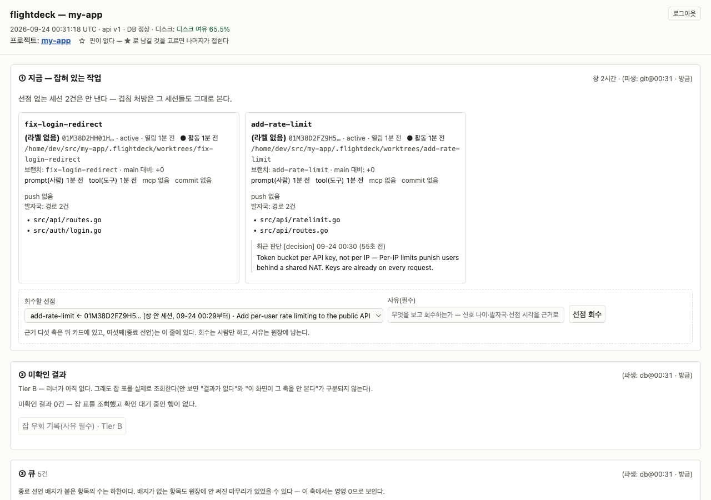

**English** | [한국어](README.ko.md)

# flightdeck

**A coordination layer for parallel coding-agent sessions.** Claude Code and codex sessions register
with one self-hosted server and work while seeing what the others are doing.

Sessions have no way to talk to each other, so each one *guesses* what the others picked up — and when
the guess is wrong, it redoes work another session is already doing. flightdeck removes the guess: who is
active, which paths they touch and what they claimed are **derived from git and the database** and shown
to every session.

Open a new session and the board appears before you type anything:

```
보드 · my-app · 2026-08-13 06:40 UTC · 파생 git@06:40:08 최신
잡혀 있는 작업 0건 (선점 기준이다 — 세션의 생사가 아니다)

잡혀 있는 작업이 없다 — 아무 세션도 큐 항목을 쥐고 있지 않다. 서버 장애가 아니다.
창 밖 73건 (가장 오래된 신호 8일 10시간 전) — 창은 표시 구간이지 생존 판정이 아니다
큐 열림 4건
  · 19시간 22분·티클러(08-19 발화) · fd-folded-multi-turn-drain-unmeasured — 다턴 배수가 미실측이다
  · 18시간 41분·티클러(08-26 발화) · fd-lane-turn-remeasure-… — lane-turn 축을 재측한다
랜딩 레인 0건(질의는 돌았다)
```

The same board is also served as a read-only dashboard at <http://localhost:7420>:



<sub>Captured from a demo server loaded with synthetic data (`my-app`).</sub>

> **flightdeck speaks Korean by default. Set `FD_LANG=en` for English.** The board, the dashboard,
> pick/land replies and overlap prescriptions then come out in English; lines the translation table
> does not cover yet (`fd doctor`, the login page, rarer diagnostics) stay in Korean, whole. The docs
> below quote the default Korean output and explain it in English. In the board above: no items are
> claimed, 4 queue items are open, and the landing lane is empty.

## Highlights

- **Claims, not locks** — `pick` claims a queue item; its id becomes the branch and worktree name.
  The merge is the only thing held exclusively.
- **Overlap before the merge** — hooks report uncommitted edits as you go. When two sessions touch the
  same path, both hear about it at the end of the turn. Nothing is blocked.
- **A landing lane** — a serialized queue in front of the merge. `fd land` exits 1 unless it is your
  turn, so `fd land && git merge --ff-only "$BRANCH"` is a correct one-liner.
- **Judgments that travel with the item** — record why you did it, what you rejected and what you
  deliberately left undone; whoever picks the item next gets it in full.
- **Derived, not declared** — branch, HEAD, footprints and activity signals come from git and hooks.
  There is no write API for anything that can be derived.
- **Claude Code and codex on one board** — sessions from both harnesses get the same overlap checks.
- **Loud when the server is down** — every session gets a banner saying what still works and what does not.

## How it works

1. **Server** — one Go binary (SQLite) in Docker. It mounts your repositories read-only and reads
   branches, commits and uncommitted changes itself.
2. **Hooks** — register the session, send activity signals and edit footprints, and inject
   prescriptions such as overlaps when a turn ends.
3. **Tools** — agents call MCP tools; people call the `fd` command. Same operations either way.
4. **Dashboard** — one read-only page at <http://localhost:7420>.

One session's day looks like this:

```
session opens   the SessionStart hook injects the board
pick            recommends what to take (does not claim)
pick(item_id)   claim + item body + linked judgments + worktree commands
work            the PostToolUse hook reports a footprint for every edit
finish          judgment + followups + close + release, in one transaction
land            queue for the landing lane → merge on your turn → land(result: ok)
```

Overlap, the landing lane, item states and activity signals are covered in [Concepts](docs/concepts.md).

## Quick start

You need **Docker** (server machine), **Go 1.25+** (every machine that runs sessions — `bin/fd` builds
on first use) and git.

**1. Start the server** — once, on one machine.

```bash
git clone https://github.com/Kweiza/flightdeck.git
cd flightdeck
docker compose up -d
curl -s localhost:7420/healthz     # {"ok":true,"api_version":"1","db_ok":true,…}
```

**2. Install the plugin** — on every machine that runs sessions.

```
/plugin marketplace add Kweiza/flightdeck
/plugin install flightdeck@flightdeck
```

**3. Open a session.** If the board shows up first, you are done. Start work with `/fd-pickup`.

> The `/fd-setup` skill can do steps 1 and 2 for you — it asks whether this machine is the server or a
> client, and installs only what is missing, after your approval.

- **Server on another machine?** Give sessions `FD_URL=http://<server>:7420` (and `FD_TOKEN` if you set one).
- **Without Docker:** `cd server && go run ./cmd/fd serve --addr :7420 --db ~/.flightdeck/fd.db`.
  It points at the same database as the container, so **never run both.**
- **Already installed as `flightdeck@kweiza-cc-plugins`?** Keep it — it fetches this repository. Do not enable both.

## Usage

### Inside a session — 10 MCP tools

There are four to remember: claim (`pick`) · record (`note`) · close (`finish`) · queue (`land`).

| Tool | What it does |
|---|---|
| `board` | Who holds what right now |
| `pick` | No arguments: recommend only. `item_id`: claim. `leave`: release |
| `note` | Record a judgment — `decision` `handoff` `blocked` `ask` `rejected` `not-done` `verified` `draft` |
| `add` | Create a queue item. The id becomes the branch name |
| `finish` | Judgment + followups + close + release, in one transaction |
| `land` | Queue for the landing lane (or a named resource) / report and release |
| `alloc` | Atomic counter — for logical sequence numbers such as revision counts |
| `label` | Display-only tags |
| `amend` | Fix an item's title, body or paths. Old values stay in the revision history |
| `show` | Read one item — closed ones too |

### From the terminal — `fd`

```bash
fd status                         # server status banner + board
fd next                           # recommendation only
fd pick <item-id>                 # claim
fd finish <item-id> --outcome done --body "why · rejected · not done · verified"
fd land && git merge --ff-only "$BRANCH"
fd doctor                         # actually measure this machine and the server
```

### 4 skills

| Skill | When |
|---|---|
| `/fd-setup` | First time on a machine — decide server vs. client, install and start only what is missing |
| `/fd-pickup` | Starting a session — board → recommendation → claim → read the linked judgments |
| `/fd-handoff` | Wrapping up — judgment, followups, close and release in one call |
| `/fd-update` | Bring server, plugin and DB up to date |

Every parameter and the habits that go with them are in the [Tool reference](docs/reference.md).

### Owner kanban: `board/`

A web board where a person sees the queue as a kanban and answers on the spot (one Python stdlib file, a host process).
Columns come from labels (`status:running` · `status:owner` · `status:owner-done` · `status:owner-ask`); cards are drawn from
convention lines in the body (`미리보기:` · `그림:` · `커밋:` · `소유자:` · `선택:` …). Sessions receive the convention as one line
of the MCP instructions. Install, configuration and the full convention: [board/README.md](board/README.md).

## codex

```bash
fd setup --install-codex   # ~/.local/bin/fd-hook · ~/.local/bin/fd · ~/.codex/hooks.json
codex                      # open the TUI once and approve "Hooks need review"
```

- **Until approved, the hooks silently do not run.** Check with the codex section of `fd doctor`.
- codex's default sandbox cuts the network — `codex -c sandbox_workspace_write.network_access=true`.
- Put `~/.local/bin` on your PATH. codex has no MCP tools; use the `fd` command.

Why it is built this way, and the full table of what works, is in [Using it from codex](docs/codex.md).

## Configuration

The server reads environment variables through compose; sessions read `~/.flightdeck/config.json`
(written by `fd setup`) or environment variables. The Postgres ledger's variables (`FD_PG_*`, `FD_BACKUP_HOST`) are read only when the override `compose.postgres.yaml` is layered on (see "Postgres ledger" below).

| Variable | Side | Meaning |
|---|---|---|
| `FD_TOKEN` | server · session | Auth token. Without it the server runs unauthenticated, and `/healthz` says so |
| `FD_REPOS` | server | Where your repositories live (default `$HOME`). Everything derived comes from here — **keep it across upgrades** |
| `FD_REPOS2`–`FD_REPOS4` | server | Extra mounts when repositories live in several trees |
| `FD_UID` · `FD_GID` | server | Host user and group id (default 1000) |
| `FD_LEDGER_HOST` | server | Where the ledger backup goes (default `~/.flightdeck-ledger`) |
| `FD_BACKUP_DIR` | server | Where `fd migrate` writes the dump it takes before upgrading a Postgres ledger (`--backup-dir` wins; when both are empty, `/backups` if it exists). The Postgres layer of compose sets it to `/backups` (on the host, `FD_BACKUP_HOST`). **Give each deployment its own directory**: a test system cloned by physical replication shares the ledger identity (cluster identifier and database name) with its source, so in a shared directory a rollback could pick the other deployment's dump |
| `FD_DUMP_TIMEOUT` | server | Deadline for one dump of a Postgres ledger (Go duration, default `30m`, at least 1s). The dump `fd migrate` takes before upgrading and the daily dump of `db-backup` use the same value: for both it is "this ledger's normal dump time plus headroom". Business writes wait while the pre-upgrade dump runs, so if the dump stalls (say the backup volume stops responding) this is the longest they stay blocked. Past the deadline pg_dump is stopped, the server drops the migrator's connection and its locks, and the version is not raised. The daily dump stops pg_dump past the deadline and counts the day as failed (a stalled dump holding table locks makes the DDL of `fd migrate` fail). Raise it if a large ledger's normal dump takes longer |
| `FD_BACKUP_HOST` | server | The dump directory of the Postgres layer (default `~/.flightdeck-backups`). The dump `fd migrate` takes before upgrading goes right in it, the daily dumps of `db-backup` into its `daily/<db>/` (newest 14 kept). **Create it beforehand** (owner `FD_UID`, mode `0700`) and **give each deployment its own**: two deployments with the same database name sharing one directory would judge freshness by each other's dumps and rotate each other's dumps away. Setup is in "Running on Postgres" below |
| `FD_PG_SERVER_PGPASS_HOST` · `FD_PG_BACKUP_PGPASS_HOST` | server | The pgpass files of the Postgres layer's two login accounts (server and daily dump). **No default**: if one is empty, `up` with the Postgres layer stops. Owner `FD_UID`, mode `0600`, line `db:5432:<db>:<account>:<password>`. They are the only place the passwords live (never in environment variables, command lines or URLs). **Keep them outside the server's mounts**: the server reads `FD_REPOS` (the whole home by default) (see "Running on Postgres" below) |
| `FD_PG_DATABASE` · `FD_PG_SERVER_USER` · `FD_PG_BACKUP_USER` | server | Database and login account names of the Postgres layer (default `flightdeck`, `fd_server` and `fd_backup`; lowercase letters, digits and `_` only). `db-roles` creates and checks the accounts: the server account is a member of `fd_app`, the dump account of `pg_read_all_data`, and neither has privileged attributes. Each database gets its own dump directory (`daily/<db>/`), so after switching databases the new one neither counts nor deletes the old one's dumps |
| `FD_URL` | session | Server address (default `http://127.0.0.1:7420`) |
| `FD_STATE_DIR` | session | Put the state files (outbox, caches, machine id) in one place |
| `FD_LANG` | server · session | Output language. `en` for English (default Korean). The server side covers the dashboard; the session side covers the CLI, hooks and MCP replies |

The traps behind each one are in [Running the server](docs/server.md).

`FD_LANG=en` translates **at the output boundary**: the board, the dashboard, add · next · pick · note ·
finish · show, land, the tail and Stop prescriptions are covered first. A line the table
(`server/internal/lang/catalog.go`) does not cover stays in Korean as a whole — no half-translated
lines. `fd doctor`, the login page and rarer diagnostics are still Korean.

## Postgres ledger

The default deployment keeps its ledger in one SQLite file (`~/.flightdeck/fd.db`). The Postgres ledger is on **only when you
choose it**: layering the override file `compose.postgres.yaml` over `compose.yaml` adds the ledger database (`db`,
Postgres 17), a one-shot for the login accounts (`db-roles`) and the daily dump (`db-backup`), and points `migrate` and the
server at that database. A plain `docker compose up` without the override is still SQLite in this version.

| Service | Connects as | Path · job |
|---|---|---|
| `migrate` | superuser `postgres` | The socket volume (trust). Raises the schema and runs the manual admin commands (import, export, restore, psql) |
| `db-roles` | superuser | The socket. Creates the two login accounts, checks them and sets their passwords (`deploy/db-roles.sh`). An account that does not match is left alone and the run stops |
| `flightdeck` | the server account (member of `fd_app`) | TCP `db:5432`, a pgpass file |
| `db-backup` | the dump account (member of `pg_read_all_data`) | TCP, a pgpass file |

The superuser has no password (it is initialised with a random value nobody knows). It cannot connect over the network;
only `migrate` and `db-roles`, which mount the socket volume, can. `db` publishes no port.

### Running on Postgres

**Setup** - once, as the `FD_UID` user.

```bash
# 1. Two volumes. Fixed names outside any project, so the ledger stays the same when each version lives in another
#    directory, and `down -v` cannot remove them. Compose does not create them: if one is missing, `up` stops instead of
#    creating an empty ledger.
docker volume create flightdeck-pgdata && docker volume create flightdeck-pgrun

# 2. The dump directory. If it is missing, Docker on Linux creates it root-owned 0755 and the first dump cannot write.
install -d -m 0700 "${FD_BACKUP_HOST:-$HOME/.flightdeck-backups}"

# 3. A pgpass for each login account. Outside the server's mounts (see the star note), owner FD_UID, mode 0600, one line each.
sudo install -d -m 0700 -o "$(id -u)" -g "$(id -g)" /etc/flightdeck
(umask 077
 printf 'db:5432:flightdeck:fd_server:%s\n' "$(openssl rand -hex 24)" > /etc/flightdeck/server.pgpass
 printf 'db:5432:flightdeck:fd_backup:%s\n' "$(openssl rand -hex 24)" > /etc/flightdeck/backup.pgpass)

# 4. Write the choice down in one file. No passwords in it, only file locations.
cat > ~/.flightdeck/compose.env <<'EOF'
COMPOSE_FILE=compose.yaml:compose.postgres.yaml
FD_PG_SERVER_PGPASS_HOST=/etc/flightdeck/server.pgpass
FD_PG_BACKUP_PGPASS_HOST=/etc/flightdeck/backup.pgpass
EOF
fdc() { COMPOSE_ENV_FILES="$HOME/.flightdeck/compose.env" docker compose "$@"; }   # keep it in your shell config
```

- `fdc` hands that file to compose as its env file (`COMPOSE_ENV_FILES`, the same as `--env-file`), and `COMPOSE_FILE`
  layers the override. The paths are relative to the directory compose runs in, so run it from the root of the repository
  (or of the installed plugin). Give the other settings (`FD_TOKEN`, `FD_REPOS`, `FD_UID`, …) in the shell as before: shell
  values win over the file, and with this file the directory's `.env` is not read. The `fd-update` skill passes the file
  the same way when it exists.
- Passwords must be printable ASCII without spaces, backslashes or colons. The server (pgx) and the daily dump (libpq) read
  the same file and the two parse anything else differently. `db-roles` refuses a line that does not fit and names its line
  number (never the password).
- If you change the database or account names (`FD_PG_DATABASE`, `FD_PG_SERVER_USER`, `FD_PG_BACKUP_USER`, in compose.env),
  change the pgpass lines too.

★ **Keep the pgpass files outside the server's mounts.** The server runs as the same uid and mounts `FD_REPOS` (the whole home
by default) read-only. Inside the home, even at `0600`, the server could read the dump account's password too. That is why
compose has no default for either location: if one is empty, `up` stops.

**Start**

```bash
fdc up -d --build
fdc ps                              # db, flightdeck and db-backup healthy; migrate and db-roles Exited (0)
curl -s localhost:7420/healthz      # db_ok and db_locale_ok are true
```

On an empty ledger `migrate` lays the baseline first. **To bring a SQLite ledger along**, do not start this way; follow
"Upgrade: SQLite ledger to Postgres" below. Once the server writes to an empty ledger, the import refuses.

**Admin commands** run in the `migrate` service. The ledger (`/data`), the dump directory (`/backups`), psql, pg_dump and
pg_restore are all there, and it connects as the superuser over the socket. Use `--no-deps` while `db` is up.

```bash
fdc run --rm --no-deps migrate selfcheck                                                # version and planned steps
sql() { fdc run --rm --no-deps --entrypoint psql migrate -X -v ON_ERROR_STOP=1 "$@"; }    # superuser psql
```

- **Run `fdc stop db-backup` before running `fd migrate` by hand.** pg_dump holds a lock on every table until it ends, and the
  DDL that raises the version fails when it cannot take that lock within lock_timeout (5s). When `fdc up` recreates migrate
  (new image or settings), compose stops the daily dump first and starts it again after migrate succeeds (`restart: true`
  in `depends_on`). `run` and `up --no-deps migrate` do not do that.
- **To change the passwords**, edit both pgpass files **in place** (replacing a file with a new one makes it disappear inside
  the containers that mount it), then `fdc up -d --force-recreate --no-deps db-roles flightdeck db-backup`. The server reads
  its file once at startup.

★ **One ledger, one override.** After the move, typing `docker compose` instead of `fdc` starts the default path (SQLite).
The move renames the old SQLite file, so that server starts on an **empty** SQLite ledger; the moved ledger is still in
Postgres. Take it down with `docker compose down`, remove the new empty `~/.flightdeck/fd.db` (and its `-wal` and `-shm`),
and start again with `fdc up -d`.

### Upgrade: SQLite ledger to Postgres

This takes the ledger you built on SQLite into a Postgres ledger. The server is down during the move. For 72 hours afterwards
you can go back to SQLite, carrying along what was written in Postgres ("Going back within 72 hours" below).

**The ledger must be at version 18.** The import only takes the last SQLite version (18). An older ledger is raised first on
this version's default path: that is step 3, and go on to step 4 only once it shows version 18.

```bash
# 0. Finish the setup of "Running on Postgres" (volumes, dump directory, pgpass, compose.env, fdc). Do not start it.
# 1. Read the current mounts. FD_REPOS and friends only survive in the mounts and cannot be read once the container is
#    down. Give those values to the shell of the commands below.
docker inspect flightdeck --format '{{range .Mounts}}{{.Source}} -> {{.Destination}} {{if .RW}}rw{{else}}ro{{end}}{{"\n"}}{{end}}'
# 2. Take the server down and build this version's image.
docker compose down
docker compose build
# 3. Raise the SQLite ledger to this version (nothing happens if it is at 18). selfcheck must report schema version 18.
docker compose run --rm --no-deps migrate migrate --db /data/fd.db
docker compose run --rm --no-deps migrate selfcheck --db /data/fd.db
# 4. Start the Postgres ledger and lay only the baseline (stops at version 18). db starts with it.
fdc run --rm migrate migrate --to 18
# 5. Dry run, move, compare.
fdc run --rm --no-deps migrate migrate import-sqlite --from /data/fd.db --dry-run
fdc run --rm --no-deps migrate migrate import-sqlite --from /data/fd.db
fdc run --rm --no-deps migrate migrate verify --from /data/fd.db
# 6. Rename the moved SQLite ledger and make it read-only. Move its side files (-wal, -shm) with it: the import opens the
#    source read-only and still leaves empty side files.
t=$(date -u +%Y%m%dT%H%M%SZ)
for s in '' -wal -shm; do [ ! -e ~/.flightdeck/fd.db$s ] || mv ~/.flightdeck/fd.db$s ~/.flightdeck/fd.db.pre-pg-$t$s; done
chmod 0444 ~/.flightdeck/fd.db.pre-pg-$t
# 7. Start on the Postgres ledger. It worked if the board shows the moved items.
fdc up -d
curl -s localhost:7420/healthz      # db_ok and db_locale_ok are true
```

- If the dry run or the move in step 5 refuses or fails, nothing is committed (one transaction), and the SQLite ledger was
  only read. Fix the cause and run again from step 5, or go back to SQLite with `fdc down` and `docker compose up -d`.
- The refusals and the comparison in detail are in "Moving a SQLite ledger to Postgres" below.

#### Going back within 72 hours

The 72 hours after the move are the rollback window. `export-sqlite` moves the Postgres ledger into a **new** SQLite file at
version 18, so the items, claims and judgments written in Postgres after the move come back too. During the window, do not
update to a flightdeck version that raises the Postgres schema past 18: `export-sqlite` only takes a version-18 ledger.

```bash
# 1. Stop the server and the daily dump (leave db up). The export refuses while other connections are attached.
fdc stop flightdeck db-backup
# 2. Dry run, move, compare. Do not skip the compare.
fdc run --rm --no-deps migrate migrate export-sqlite --to /data/fd-back.db --dry-run
fdc run --rm --no-deps migrate migrate export-sqlite --to /data/fd-back.db
fdc run --rm --no-deps migrate migrate verify --from /data/fd-back.db
# 3. Take the Postgres layer down and put the new file in the ledger's place (side files too).
fdc down
for s in '' -wal -shm; do [ ! -e ~/.flightdeck/fd-back.db$s ] || mv ~/.flightdeck/fd-back.db$s ~/.flightdeck/fd.db$s; done
# 4. Put away the file that chose Postgres and start on the default path (SQLite). Left in place, the next update would
#    layer Postgres again.
mv ~/.flightdeck/compose.env ~/.flightdeck/compose.env.off
docker compose up -d
```

- If `~/.flightdeck/fd.db` already exists at step 3 (an empty ledger from starting the default path by mistake after the
  move), look at it and remove it before overwriting.
- If verify does not match, delete `fd-back.db`, keep the server down, and start again from step 1.
- The Postgres ledger (volume `flightdeck-pgdata`) stays. A later move needs an empty target: the import refuses otherwise.

### Daily dumps of a Postgres ledger

The `db-backup` service writes a `pg_dump -Fc` once a day to `$FD_BACKUP_HOST/daily/<db>/fd-daily-<UTC>.dump` and keeps the
newest 14. It runs only with the Postgres layer (setup is in "Running on Postgres"). It rotates only after a dump succeeds,
and only one run works in a database's directory at a time. The container turns unhealthy when the newest dump is older
than the interval plus two checks plus the deadline (26h30m by default).

`fdc run --rm --no-deps db-backup config` prints the settings on one line. `once` takes one dump by hand (0 = dumped, or not
due yet; 1 = failed; 3 = another run is working in the same directory, nothing done).

**Restore** - in the `migrate` service (superuser over the socket; the dumps are visible under `/backups`). `sql` is the
admin command from "Running on Postgres".

```bash
fdc stop flightdeck db-backup      # drop the connections to the database you are restoring
```

1. Read from the dump which database it restores. `--create` makes the database under **the name written in the dump**, not
   the current `FD_PG_DATABASE`.

   ```bash
   fdc run --rm --no-deps --entrypoint pg_restore migrate -l /backups/daily/<db dir>/fd-daily-<UTC>.dump | grep '^; *dbname:'
   ```

   If a database by that name exists, do not drop it; **rename it and keep it** (`<db>` is the name read above):
   `sql -d postgres -c 'ALTER DATABASE "<db>" RENAME TO "<db>_before_restore"'`. Drop the old one after the check in step 4.
2. Roles are cluster-wide, so they are not in the dump. Restoring into the same volume (`flightdeck-pgdata`), they already
   exist. If the volume itself is gone, create a new one, run `fdc up -d db-roles` to create the group roles, the login
   accounts and an empty ledger, then begin with the rename in step 1.
3. Restore the whole database. `--create` also restores the database-level privileges (`TEMPORARY` revoked from PUBLIC);
   restoring into a database created beforehand loses that.

   ```bash
   fdc run --rm --no-deps --entrypoint pg_restore migrate -d postgres --create --exit-on-error /backups/daily/<db dir>/fd-daily-<UTC>.dump
   ```

4. Check the accounts again (`fdc up -d db-roles`) and connect **as the server account** to check. The tables must be
   readable (the membership) and `TEMPORARY` must be gone. If either is off it stops with an error and a nonzero exit
   (`ON_ERROR_STOP`; a remaining privilege triggers a deliberate division by zero). If you renamed them, use your names in
   place of `fd_server` and `flightdeck`.

   ```bash
   fdc run --rm --no-deps --entrypoint psql flightdeck -X -h db -U fd_server -d flightdeck -v ON_ERROR_STOP=1 \
     -c 'SELECT count(*) FROM judgment' \
     -c "SELECT 1 / (NOT has_database_privilege(current_database(), 'TEMPORARY'))::int"
   ```

5. Start again with `fdc up -d`. Drop the renamed old database once the check is done
   (`sql -d postgres -c 'DROP DATABASE "<db>_before_restore"'`).

### Moving a SQLite ledger to Postgres

In a compose deployment, move with "Upgrade: SQLite ledger to Postgres" above. This section covers what the commands
themselves do and refuse; `<URL>` below connects as the superuser or a member of `fd_owner` (in the compose `migrate` service
`FD_DB` is that URL, so leave out `--db`).

`fd migrate import-sqlite` moves a ledger at the last SQLite version (18) into an **empty** Postgres ledger in one
transaction. Inside that transaction it then compares the two ledgers and does not commit on any mismatch.
`fd migrate verify` runs only that comparison again (it writes nothing). The comparison covers, per table, the row count and
a fingerprint over every column, plus the identity sequences (the next number must exceed the highest number the source
ever issued); mismatched rows are listed by primary key. Exit codes: 0 = moved · matched, 1 = refused · mismatch · failure,
2 = usage.

```bash
# 1. Stop the server that writes the source. Pass the ledger file itself to --from, or, to keep a copy, take one with
#    VACUUM INTO. Do not copy it with cp (see below).
sqlite3 fd.db "VACUUM INTO 'fd-copy.db'"
# 2. Lay the baseline on the target database, stopping at the import version (18).
fd migrate --db <URL> --to 18
# 3. Dry run: runs the same transaction as the real import to the end and rolls it back instead of committing.
fd migrate import-sqlite --from fd-copy.db --db <URL> --dry-run
# 4. Move. On success it prints the comparison table and the number of rows moved.
fd migrate import-sqlite --from fd-copy.db --db <URL>
# 5. (Optional) compare again before starting the server on the new ledger. Once the server writes, they differ.
fd migrate verify --from fd-copy.db --db <URL>
```

- Do not take the copy with `cp fd.db`. The SQLite ledger runs in WAL mode, so a commit lives only in `fd.db-wal` until it
  is checkpointed into the main file, and a `cp` copy loses it. The import and the comparison then both read the same copy
  and both say it matches; nothing reports the loss. `VACUUM INTO` (or `sqlite3 fd.db ".backup fd-copy.db"`) takes a
  consistent copy that includes the -wal.
- The source is opened read-only. If the `-wal` next to it holds any bytes (the server still runs, or it stopped abnormally
  before a checkpoint), the import refuses. Stop the server and run it again; if the bytes remain, take a copy with the
  `VACUUM INTO` above and pass that.
- The account must be a superuser or a member of `fd_owner`. The import restarts each sequence above the source's highest
  number (a deleted top number is never issued again), which only the owner role may do. Connected as the app role, the
  dry run refuses just as the real import does.
- Run `fd migrate verify` with the same account. The app role has no privilege (SELECT) to read the identity sequences, so
  it cannot compare them.
- A source older than version 18 is refused. First upgrade the copy with this version of fd (`fd migrate --db <copy>`).
- A source whose tables or columns differ from version 18 (a hand-edited ledger) is refused.
- A target with even one row in a business table is refused, as is one whose identity sequence has ever issued a number
  (even after the rows were deleted), one not at version 18, or one that fails the locale gate.
- If any connection other than this run is attached to the target database (a server, psql, ...), the dry run and the real
  import both refuse and list each remaining connection's pid · role · application_name. Some writes of an attached server
  (observation records) do not take the migration lock and would interleave with the moving transaction.
- Pre-checks: NUL bytes and broken UTF-8 in text columns, broken JSON and `\u0000` in JSON columns, a storage type that does
  not match the column, NULL primary keys, colliding snapshot key digests, and foreign keys pointing at missing rows. If
  anything hits, nothing is written and each hit is listed by table · column · reason · primary key. Fix those rows in the
  copy and run it again. `fd migrate verify` does not report a match for a source that fails the pre-checks either.
- Refusals the pre-checks cannot see (a CHECK on the target, the index entry size limit, privileges) hit the dry run exactly
  as they hit the real import. The dry run also holds the migration locks as the real import does.

### Moving a Postgres ledger back to SQLite

In a compose deployment, go back with "Going back within 72 hours" above. This section covers what the command itself does
and refuses.

`fd migrate export-sqlite` is the reverse of the import. It moves a Postgres ledger at version 18 into a **new** SQLite file
(version 18) - the way back to the SQLite build, carrying the items, claims, events and judgments written on Postgres since
the import. It runs the same transaction and the same comparison as the import (row counts, fingerprints over every column,
sequences), writes into a temporary file next to the target, and gives it the `--to` name only when the comparison matches.
On a mismatch or failure (and always on a dry run) no file is left behind. Exit codes are the same as the import's.

```bash
# 1. Stop the server that writes the Postgres ledger. If any connection other than this run is attached, the export refuses
#    and lists each remaining connection's pid · role · application_name. The source is only read, in one snapshot
#    (REPEATABLE READ READ ONLY).
# 2. Dry run: runs the same path to the end in a temporary file (naming is tried with a throwaway hard link in the same
#    directory), then deletes that file.
fd migrate export-sqlite --db <URL> --to fd-back.db --dry-run
# 3. Move. On success it prints the comparison table and "moved N rows, the comparison matched -> fd-back.db".
fd migrate export-sqlite --db <URL> --to fd-back.db
# 4. Always compare again before starting a server on the new file. This is the import's verify, unchanged.
fd migrate verify --from fd-back.db --db <URL>
```

- Do not skip step 4. The comparison before commit matches the moved snapshot against itself, so a write that a server
  attached to the source committed after the connection check is neither moved nor noticed. verify reads the source again in
  a fresh snapshot and catches that mismatch. If it does not match, delete the exported file and start again from step 1
  with the server stopped.

- If a file already sits at `--to`, or a `-wal` · `-shm` · `-journal` sits next to it, the export refuses. It never
  overwrites, and a leftover `-wal` cannot be replayed into the new file.
- The source must be at version 18. A Postgres ledger upgraded past it has no place in the SQLite build and is refused. So is
  a ledger whose tables or columns differ from version 18 (a hand-edited ledger). The version and the shape are measured in
  the snapshot the export copies from. The account is the same as for the import (a superuser or a member of `fd_owner` - it
  reads the sequences).
- A source holding a value the import's pre-checks would refuse (broken JSON and the like) is refused, since the exported
  file could not be imported again.
- Sequences: the AUTOINCREMENT tables (pick_eval · resource_hold · event · landing_queue) get the highest number Postgres
  issued back into `sqlite_sequence`, so it is never issued again. item_after is a SQLite rowid table and cannot remember a
  deleted top number - its seq values (the order) move into rowid unchanged, and the next number is max(rowid)+1 as in the
  SQLite build.
- The judgment search index (judgment_fts) does not exist on Postgres, so it is not moved. It is rebuilt from the moved
  judgment rows and checked against them.
- The exported file has mode 0644, and "moved" is printed only after the directory holding the new name has been fsynced.
- Stopped with Ctrl-C or SIGTERM, the export deletes its temporary file and exits 1. Ended by SIGKILL or a power cut, it may
  leave `.<name>.export-<digits>` (with its `-wal` · `-shm` · `.link`) in the `--to` directory. While no export is running,
  find them with `ls -a <directory> | grep '^\.fd-back\.db\.export-'` and delete them. They never got the name, so they are
  not a ledger.

**Rehearsing the way back.** Before the real move, run the round trip once: a copy of the ledger → `import-sqlite` into a
test Postgres ledger → start a server on it and write a few things (an item, a claim, a judgment) → stop the server and
`export-sqlite` → check that `fd migrate verify --from <exported file> --db <URL>` matches, and that a SQLite-build server
started on the exported file shows those writes and finds the judgment by search.

## Several repositories

When one product spans several repositories, declare the members in a root `.flightdeck.yaml` and
start once from the root to coordinate them all. See [Several repositories](docs/workspaces.md).

## When the server is down

`SessionStart` injects a banner, so no agent acts as if coordination exists when it does not:

```
⚠ 조정 서버 미도달(http://localhost:7420, 마지막 접속 14:02 · 37분 전).
  되는 것: 코드 작성·커밋·조사 전부. 이미 선점한 항목의 작업.
  안 되는 것: 새 항목 선점 · 다른 세션의 현재 상태.
```

("Coordination server unreachable. Still works: writing code, committing, research, work on items you
already claimed. Does not: claiming new items, other sessions' current state.")

Reads return the last snapshot marked as stale; judgments and notes queue up and replay on reconnect.
Claims, counters and the landing lane are refused — allowing them offline would make exclusion a lie.

## Troubleshooting

Run `fd doctor` first. It names each platform axis and the server state one by one.

| Symptom | Where to look |
|---|---|
| The board is empty | If nobody holds an item, that is normal. Otherwise start with `FD_URL` in `fd doctor` |
| Hooks do nothing | Run `bin/fd` directly — without Go you get a notice |
| Tools do not show up | Is `type` in `.mcp.json` set to `stdio`? |
| `브랜치 ?(못 읽음)` ("branch ? (unreadable)") on the board | The repositories are not mounted into the server container (`FD_REPOS`) |
| No card for a codex session | Hooks are not approved yet — open the `codex` TUI once |

## Design principles

1. **No write API for anything derivable.** Enforced by absence, not by validation.
2. **No feature that adds concepts a session must memorize.** Add tools and the tail of the
   discipline — handoffs, followups — is the first thing to drop.
3. **REST is the consistency path; MCP is a thin shell over it.** Both call the same functions.

And there is **no liveness boolean.** flightdeck never answers "is that session alive?" with yes or no;
it shows the age of each signal instead, because that judgment was wrong twice in measurement. The
reasons, and the list of what was deliberately not built, are in [Concepts](docs/concepts.md) and the
design of record, [DESIGN.md](DESIGN.md) (Korean).

## In production

In the August 2026 ledger, **24 sessions on one machine signalled within the same 10-minute window**,
and 22 of them were touching the same two repositories. In the first ten days, 601 overlap
prescriptions went out and sessions queued for landing 157 times across the two repositories.

## Development

The repository root is the plugin root. The server, CLI, MCP server and hooks all come from one Go
module in `server/`.

```bash
cd server
gofmt -l .                                            # must print nothing
go vet ./... && GOOS=linux go vet ./... && GOOS=windows go vet ./...
# tests: start the PG test container, pass it as FD_TEST_PG, take it down afterwards (takes a few minutes)
(p=fdtest-$(basename "$(dirname "$PWD")"); trap 'docker compose -f ../compose.test.yaml -p "$p" down' EXIT; trap 'exit 143' HUP INT TERM; docker compose -f ../compose.test.yaml -p "$p" up -d --wait && FD_TEST_PG="postgres://postgres@$(docker compose -f ../compose.test.yaml -p "$p" port pg-test 5432)/postgres?sslmode=disable" go test ./...)
```

The tests run on Postgres. The test-only container is `compose.test.yaml` (Docker required), and the tests
take its address from `FD_TEST_PG`. Without `FD_TEST_PG` the tests **fail** rather than skip. The one line
above starts, runs and takes down, and it takes the container down even when a test fails or the shell is cut off.

A push that changes code bumps `version` in `.claude-plugin/plugin.json` too — otherwise
`/plugin update` never fetches the new code. Layout and the reasons behind each gate are in
[Development](docs/development.md).

## Origin

flightdeck grew inside the plugin collection [kweiza-cc-plugins](https://github.com/Kweiza/kweiza-cc-plugins)
as `plugins/flightdeck`, and was split out here on 2026-09-24 at 0.38.3. Earlier history, and the commit
shas that the docs and code comments cite, live in that repository.

## License

MIT — see [LICENSE](LICENSE).
